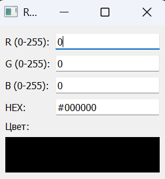
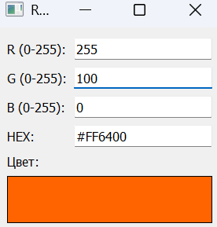
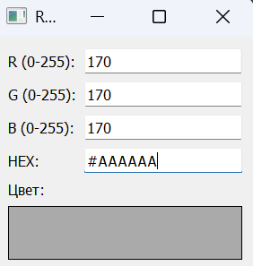

# Лабораторная работа №2
## Аникина Дарья 6233

В качестве варианта реализации был выбран конвертер из RGB в HEX представление цвета.

## Конвертер RGB – HEX

В файле `cl1.py` представлена реализация класса RgbToHex. В нём RGB преобразуется в HEX формат. 

В файле `cl2.py` представлена реализация класса HexToRgb. В нём, наоборот, HEX преобразуется в RGB формат.

В экземпляре класса **Data** храниться текущее значение цвета в RGB.

Класс **Window** реализует окно конвертера.
Используется виджет ввода  - QLineEdit, с валидатором ограничений. В области предпросмотра цвет меняется с помощью setStyleSheet на основе текущего rgb значения. С помощью обработчиков событий - onRgbEdited и onHexEdited считываются изменения.

## Финальный результат

