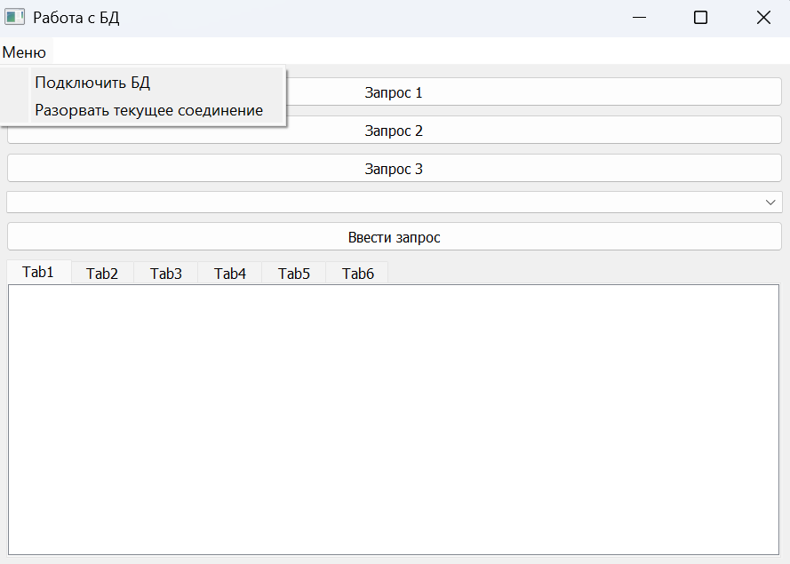
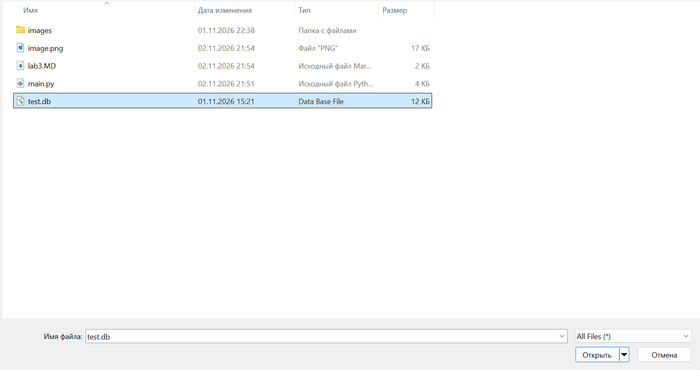
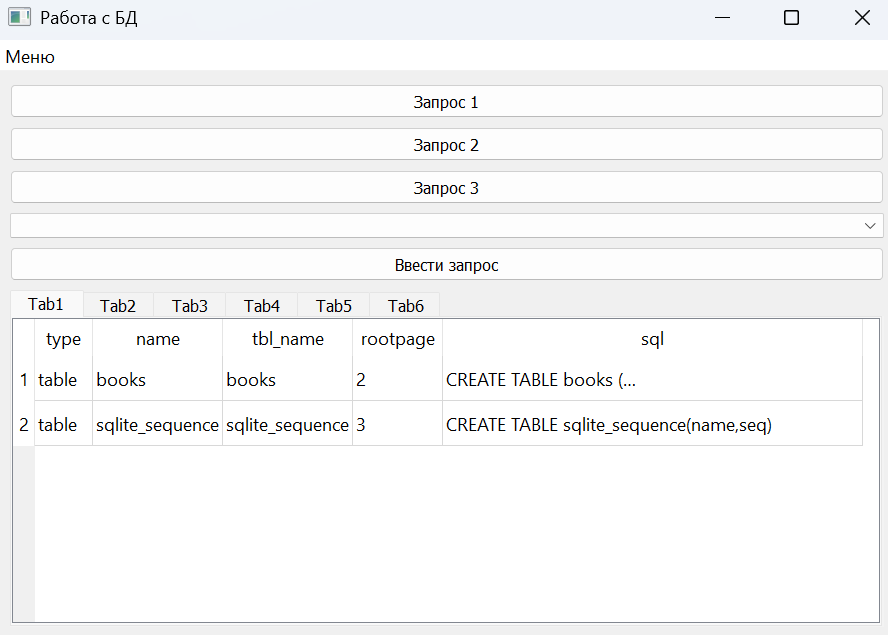
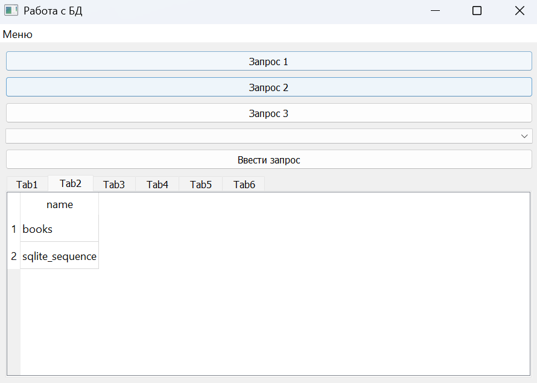
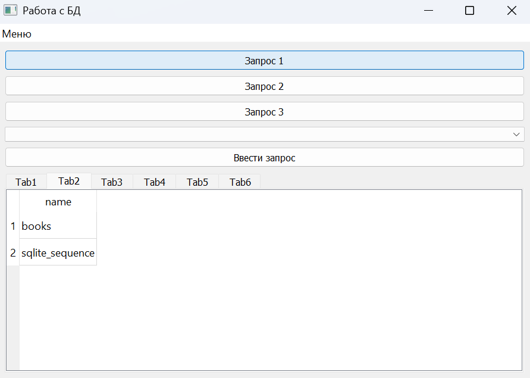
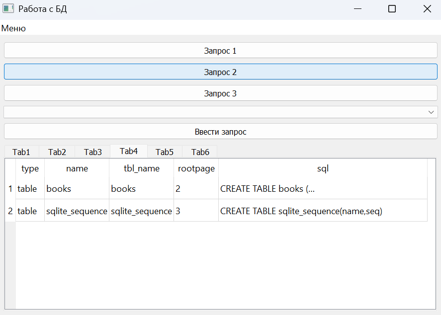
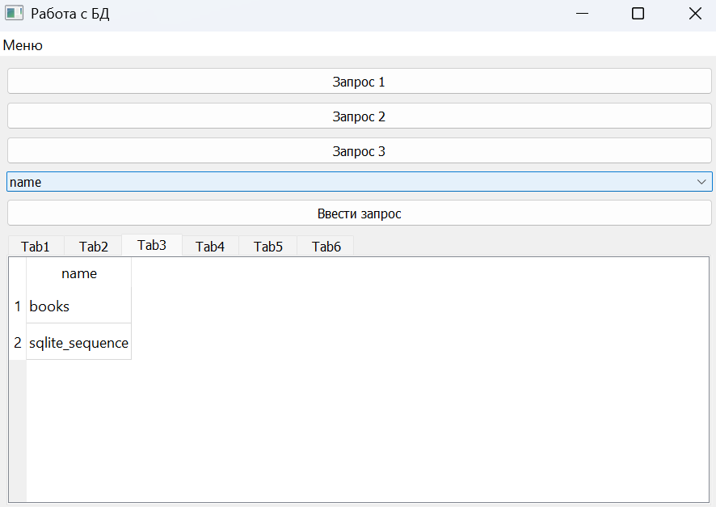
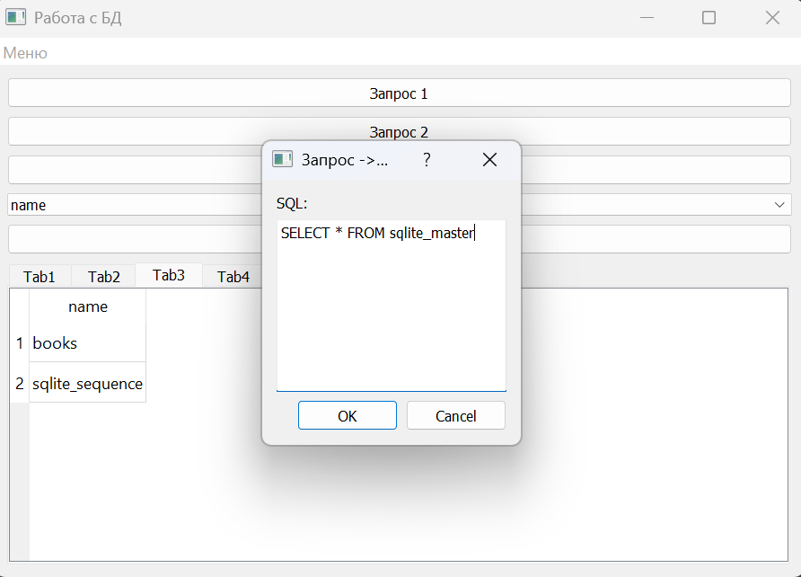

# Лабораторная работа №2
## Аникина Дарья 6233

Приложение подключается к файлу SQLite и показывает результаты SQL-запросов в таблицах на пяти вкладках.

### Инициализация БД

Для получения файла БД используется функция init_db() в которая создаёт таблицу и сохраняет БД

## Работа с БД

* Подключение к БД по кнопке "Подключить БД"

* После успешного подключения в Tab1 сразу выводится `SELECT * FROM sqlite_master`, список колонок заполняется.

* Результат каждого запроса показывается на своей вкладке, и она автоматически становится активной.

* При выборе колонки выводится результат выполнения запроса по выбранной колонке.

* В модальном окне можно ввести свой запрос

