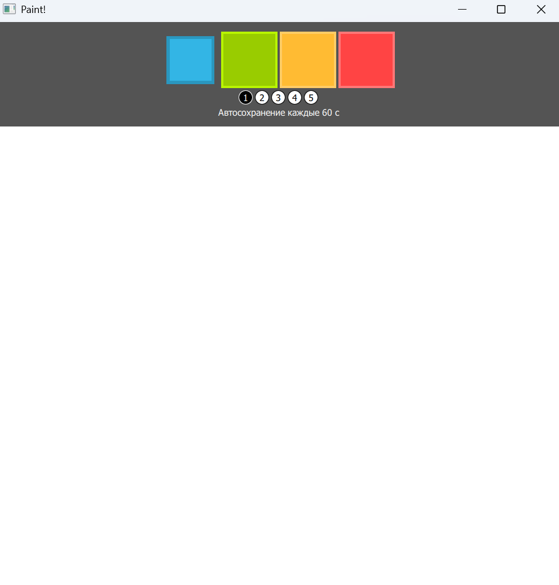
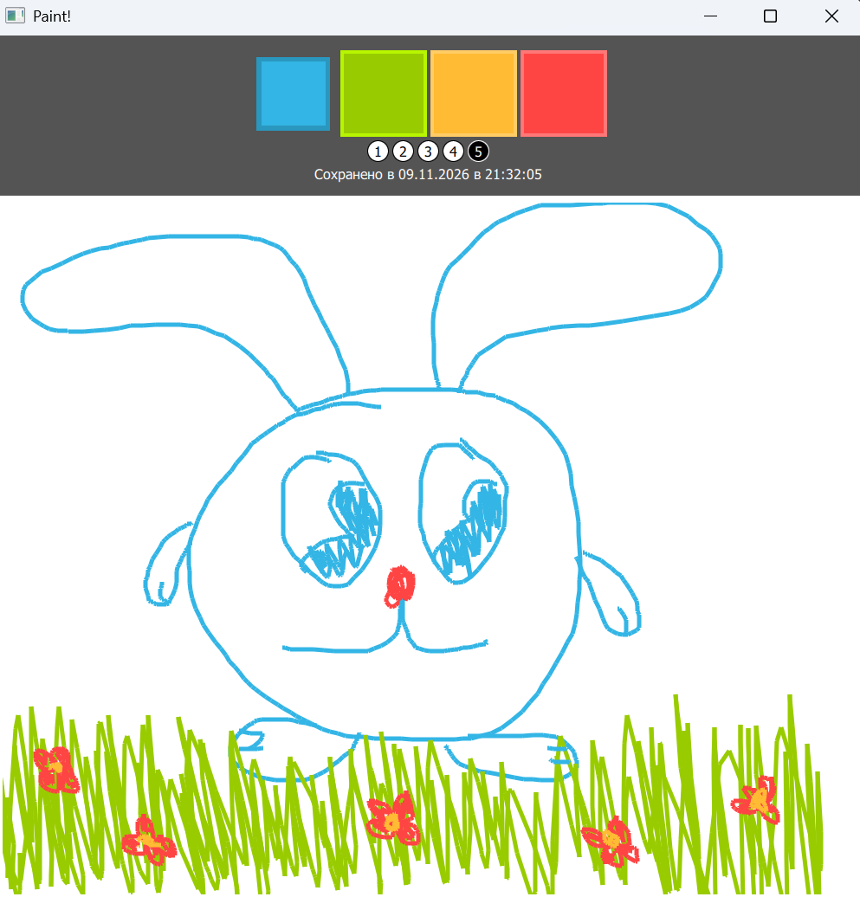
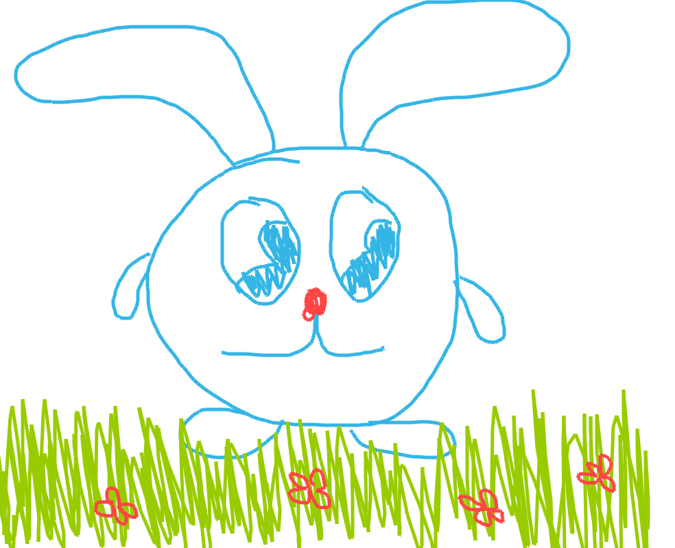

# Лабораторная работа №4
## Аникина Дарья 6233

В классе Inerface реализована логика сохранения области рисования canvas по таймеру в файл

## Автосохранения

Реализован класс Interface, на входи идёт сам холст, количество секунд до автосохранения и папка для сохранения.

Также отдельно в интерфейс выведен текст о состоянии автосохранения, выводится статус сохранения - когда оно было в последний раз

Кроме этого, добавлен флаг not_saved, который меняется только при изменении на холсте. Если изменений не было - сохраняться ничего не будет.

Интерфейс:

Рисунок:

Его автосохранение:

